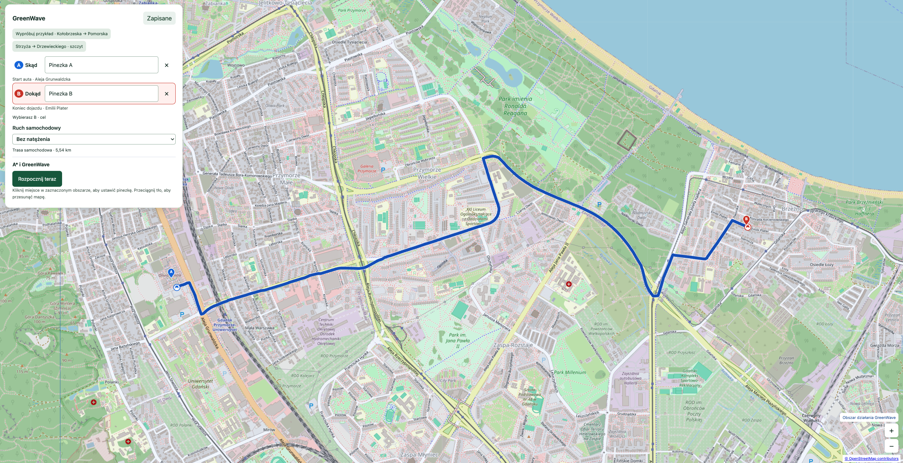
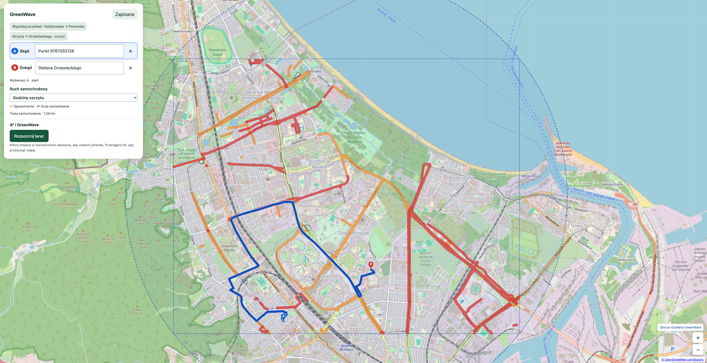
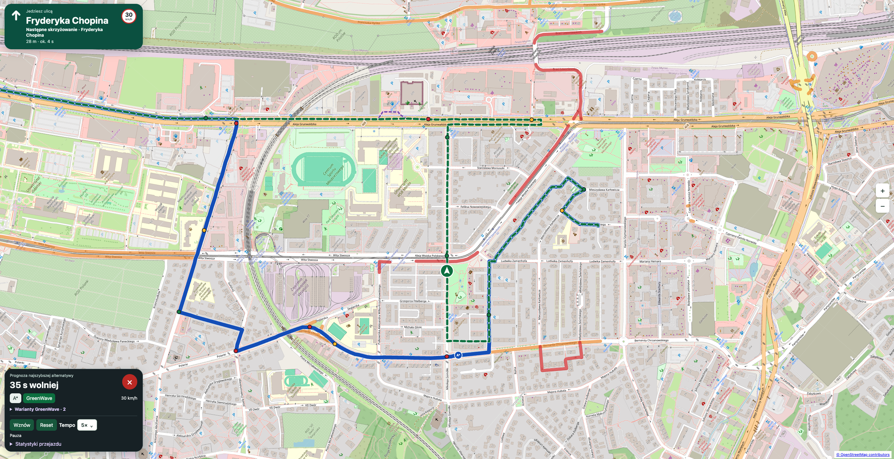
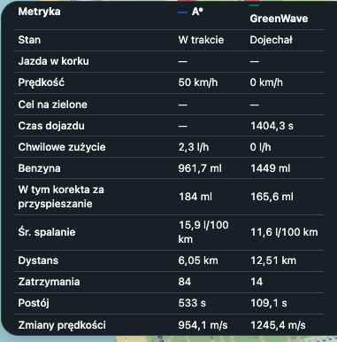
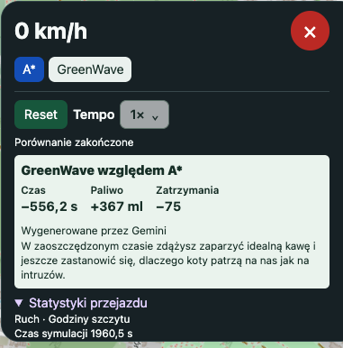
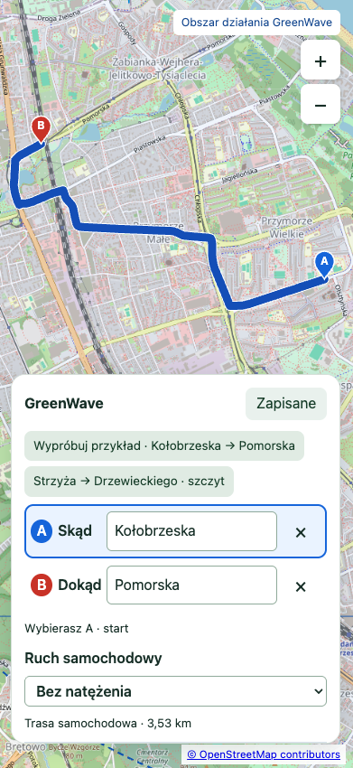
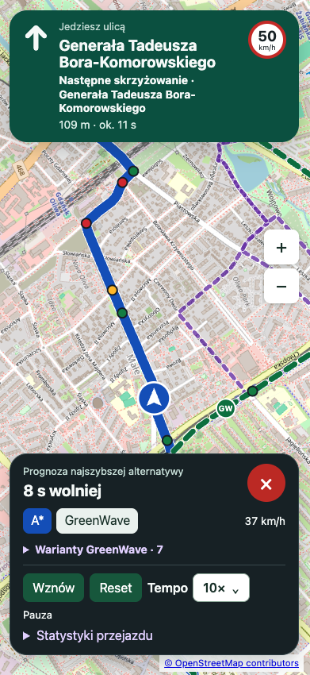
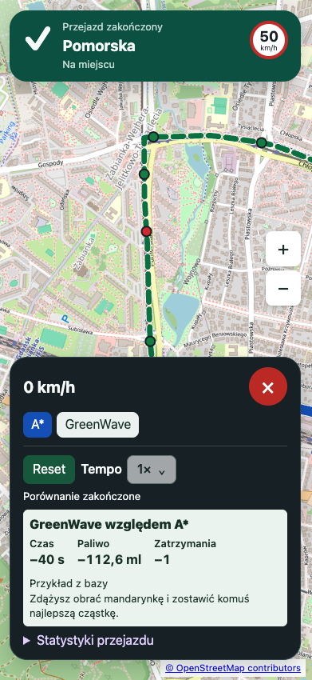
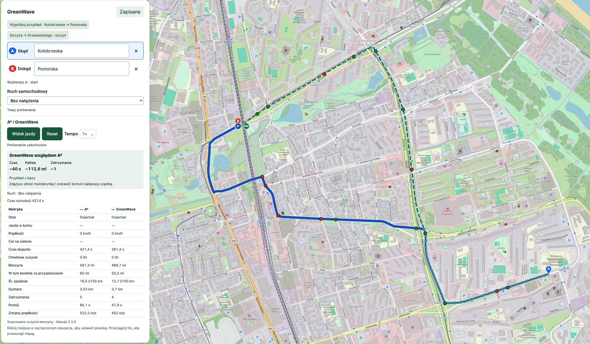
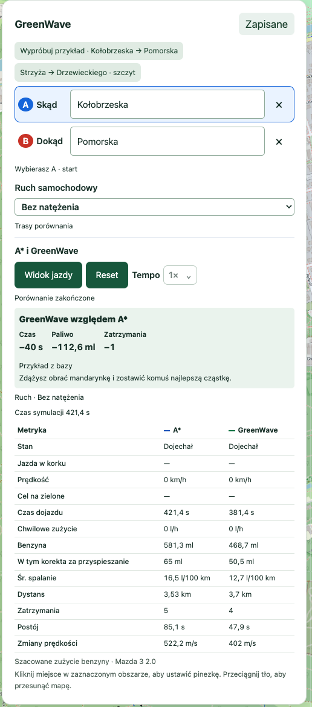

# GreenWave

GreenWave is a full-stack transport simulation. It compares a standard A* baseline with my signal-aware GreenWave approach on a road map of Gdańsk. The interface adapts to large desktop displays and small phone screens, including route selection, driving view and results.

## Why GreenWave exists

I wanted to reduce long urban journey times and see when smoother driving could also save fuel. A route that looks fast based on distance and speed limits can lose time at red lights or in stop-and-go traffic. The A* baseline chooses its route using road travel costs. GreenWave uses simulated signal information and congestion estimates to decide whether to change its speed or route. Both cars drive under the same simulated conditions.

My target is for GreenWave to arrive faster in 98% of simulated comparisons with the A* baseline. That percentage is an unverified target. On short trips where both routes cover similar distances, signal awareness can reduce estimated fuel use by avoiding stops and repeated acceleration.

- **Explore routing trade-offs.** Replay the same journey in different traffic modes and see when a detour saves time, when it costs fuel, and when staying on the main road works best.
- **Understand routing decisions.** Follow the simulated car, inspect nearby signals and route options, and see why an alternative gained or lost its advantage.
- **Repeat an experiment.** Save the route and its settings, including the random seed. Matching scenario and engine versions make comparisons reproducible. The results can support discussion of navigation strategies and signal coordination.

## Implemented features

| Feature | What the app does |
| --- | --- |
| Interactive map | Displays a full-screen Gdańsk map with a marked simulation area, streets, route lines, signals and traffic overlays. Supports dragging, zoom buttons, mouse-wheel zoom and touch gestures. Draws the local road network when background tiles are unavailable. |
| Origin and destination | Search bundled street names and house numbers or place A/B pins on the map. Drag either pin or remove it with its clear button. The selected position stays visible and the car route starts or ends at a reachable road access point. The imported graph includes eligible service roads, parking aisles and residential streets. |
| Ready-made journeys | Load the Kołobrzeska–Pomorska example or the Strzyża–Drzewieckiego rush-hour example. The saved-trip form also offers a small synthetic test scenario. |
| Saved trips | Create, list, edit, delete or load a named configuration into the comparison. Presets store the scenario, endpoints, traffic mode, seed, speed cap, acceleration, braking, GreenWave observation distance, decision interval and run time limit. SQLite persists presets across restarts. |
| A* baseline | Chooses a route from road travel costs and keeps it throughout the run. The simulated car still responds to traffic, signals, road limits and maneuver speed limits. |
| GreenWave routing | Estimates travel and signal waits along candidate routes. Uses observed congestion, maneuver constraints and a minimum improvement before switching during a run. The default observation range is 1,500 m and the planner can consider up to ten routes when viable options exist. The map highlights alternatives and shows estimated time, signal wait, congestion delay and recent decisions. The driving panel compares the forecast for the fastest or highlighted alternative with the selected route. |
| GreenWave speed adaptation | Displays a target speed when an approaching green window is reachable. The simulation allows a boost of up to 20 km/h over the ordinary road cap on eligible approaches, subject to movement constraints. If a wait is predicted, the vehicle can reach ordinary approach speed and then coast. |
| Shared signals and vehicle physics | Both runs use the same clock, road network, vehicle model and seeded pedestrian-request timeline. Simulated fixed-cycle and pedestrian-triggered lights use a three-second yellow phase and the modeled 30 m decision rule. Cars accelerate, brake and slow for turns and junctions. |
| Traffic scenarios | Choose no congestion, normal traffic or rush hour. Orange and red overlays mark simulated slowdowns. Queued vehicles crawl, brake, stop and accelerate repeatedly. |
| Playback and driving view | Start, pause, resume or reset both runs together and choose 0.5×, 1×, 2×, 5× or 10× playback. Follow either car on a heading-up map. The view shows the current street, upcoming junction or light, distance, estimated approach time, signal countdown, speed and road speed limit when available. Return to the overview at any time. |
| Live metrics and stored results | Compare travel time, distance, speed variation, stops, stopped time, instantaneous fuel use, total gasoline, average consumption and acceleration-related fuel correction. The final summary shows signed GreenWave differences in time, fuel and stops. Completed comparisons remain available through the REST API after a restart. |
| Saved-time example | When GreenWave arrives ahead, the backend can ask Gemini for a short Polish sentence using the forecast time difference. The final result shows a sentence only when the measured saving reaches 30 seconds. The UI labels Gemini and SQLite examples separately. SQLite supplies duration-matched examples when generation is unavailable or unsuitable. Recent topics and text are checked to reduce repetition. |

## What the results represent

This is a simplified simulation of part of Gdańsk. OpenStreetMap supplies road geometry, addresses and optional background tiles. Fictional traffic lights are assigned to locations on the road graph within the simulation area. Some run on fixed cycles, and others respond to simulated pedestrian requests. All signal phases, traffic volumes and congestion are generated by the simulation. The traffic modes let you observe how a car slows down, stops, pulls away and crawls through a queue.

GreenWave can see lights on multiple branches of the directed road graph within its observation range, which defaults to 1,500 m of road distance. If normal speed would miss a known green window, the virtual car can use up to **20 km/h above its ordinary speed cap** on eligible approaches. Braking and maneuver constraints still apply. When it expects to reach a red light, GreenWave can release the throttle and coast. The fuel model counts zero injection while the car decelerates above **20 km/h** without needing engine power.

The fuel model estimates consumption for a warmed-up 2.0 L gasoline car, including idling and repeated acceleration. The road extract limits which roads and maneuvers are available. Arrival times and fuel figures reflect those assumptions and the selected scenario.

## Architecture

| Layer | Responsibility | Technology |
| --- | --- | --- |
| Backend | REST, validation, simulation clock, vehicle physics, routing and metrics | Java 21, Spring Boot, Maven |
| Frontend | Map, address search, trip forms, animation and comparison panels | React, TypeScript, Vite, SVG and CSS |
| Database | Scenarios, saved configurations, terminal results and example history | SQLite, Xerial JDBC, Hibernate and Flyway |
| Local deployment | Start both services, serve the frontend and proxy same-origin API requests | Docker Compose and nginx |

The backend and frontend live in `backend/` and `frontend/`. The backend owns the simulation state, including both routes, signal phases and fuel calculation. The browser polls the REST API and interpolates motion for display. Standalone development uses configurable CORS. Compose runs both services together and keeps the SQLite database in a mounted directory.

## How I am building the project

I use **Spec-Driven Development (SDD)**: requirements and acceptance criteria come before implementation. The approved specification in `.spec/` is the source of truth. Draft proposals are explicitly distinguished from approved decisions and implemented features.

For each feature I follow this cycle:

1. Describe its data model, API contract, business invariants and Given–When–Then criteria.
2. Use AI to review ambiguities, edge cases and concurrency concerns.
3. Review a bounded implementation plan with affected files, dependencies and checks.
4. Authorize implementation of that plan.
5. Review the changes and run appropriate automated tests.
6. Keep the specification, code and tests aligned, including after manual changes.

I remain responsible for scope, design decisions, understanding the solution and reviewing generated changes. Work is planned in small increments; I use Git branches and diff reviews for each increment.

## Development stages

| Stage | Planned outcome | Status |
| --- | --- | --- |
| 1. Requirements and specification | Layer boundaries, API, invariants and feature criteria | Draft prepared; review ongoing |
| 2. Project setup | Separate Java/React projects, pinned dependencies, CORS and local setup | Implemented and verified |
| 3. Saved trips | End-to-end CRUD with SQLite and a simple UI | Implemented and verified |
| 4. Road network | Small Gdańsk extract, validated graph and map display | Implemented |
| 5. Baseline simulation | Clock, signals, vehicle physics and A* | Implemented |
| 6. GreenWave | Limited-observation routing and speed adaptation | Implemented in the API and comparison UI |
| 7. Integration and verification | Controls, animation, results and reproducibility checks | Implemented |
| 8. Submission | Verified setup guide, MP4 demo and public GitHub repository | Local verification and recording complete. Public submission pending. |

The [implementation plan](.spec/implementation_plan.md) gives more detail. The approved 30 m yellow-light rule and open numerical defaults are recorded in the [decision register](.spec/decisions.md).

## How AI is used

I use **ChatGPT and Codex (OpenAI)** as engineering assistants and technical mentors. So far, AI has helped organize requirements, draft the architecture and specification, identify gaps and conflicting rules, define acceptance criteria, and prepare project documentation and `.gitignore`.

In stage 2, AI also implemented the Java/React skeletons, configured CORS, prepared and ran three HTTP integration tests, built the frontend and checked browser connection, failure and recovery states. In stage 3, AI also prepared the layered preset implementation, migrations, OpenAPI contract, React CRUD UI and integration tests. Testing exposed an initial null-version getter bug; AI fixed it and reran the suite. In stage 5, AI implemented the baseline simulation, map controls and regression tests. Tests exposed an issue with the last braking increment; AI corrected the stopping calculation. In stage 6, AI implemented the signal-aware planner, the shared maneuver speed limits and the related tests. In stage 7, AI connected both vehicle runs to a shared clock and built the comparison controls, map view, SQLite storage and regression tests. The app optionally uses Gemini to generate a short Polish example of what the user can do with the time saved. SQLite provides local examples when a generated sentence is unavailable.

In stage 8, I used Codex to help phrase and format the README and its screenshot captions. Codex also helped verify the setup from a clean copy. The project records the agent instructions and the checks performed. [Agent instructions](AGENTS.md) · [SDD report](docs/sdd_report.md)

## Documentation

- [Specification index](.spec/README.md)
- [Architecture](.spec/00_architecture_guidelines.md)
- [SDD workflow](.spec/sdd_workflow.md)
- [REST contract](.spec/shared/01_api_contracts.md)
- [Recruitment requirements and submission checklist](.spec/xelerit-requirements.md)

Project documentation and code comments are written in English.

## Run with Docker Compose

Start Docker Desktop, then run these commands from the repository root on a fresh checkout.

```sh
cp -n .env.example .env
docker compose up -d --build --wait
```

Open [GreenWave](http://localhost:3000) and check the [API health endpoint](http://localhost:3000/api/v1/health). Both use port 3000 by default. If you change `GREENWAVE_PORT`, use that port in both URLs. Compose starts both services, and the frontend forwards `/api/v1/` requests to the backend inside Docker. Port 8080 is available on the host when you start the standalone Java backend as described below. The backend initializes SQLite and runs Flyway migrations at startup.

Edit the root `.env` to set the optional `GEMINI_API_KEY`, the Gemini model, the browser port, the map tile URL or the SQLite data directory. Keep the Gemini key in this local file. Git ignores it and Compose passes the key only to the backend at runtime. Run `docker compose up -d --build --wait` again after editing the configuration. [Docker Compose environment configuration](https://docs.docker.com/compose/how-tos/environment-variables/variable-interpolation/)

Use `docker compose down` to stop both services. The database remains in `state/docker/greenwave.db` by default. To import an existing local database before the first start, take a SQLite backup while the source is available and put it in the configured data directory as `greenwave.db`.

```sh
mkdir -p state/docker
test -f backend/greenwave.db && test ! -e state/docker/greenwave.db && \
  sqlite3 backend/greenwave.db '.backup state/docker/greenwave.db'
```

## Local development and tests

### Prerequisites

Use JDK 21, Maven 3.9.x and Node.js 24.x with npm. Verification used Java 21.0.11, Maven 3.9.16, Node 24.14.1 and npm 11.11.0 on macOS. Downloading dependencies requires internet access. No database server, SQLite command-line installation or API key is required. Maven downloads the bundled JDBC driver.

### 1. Build and start the backend

From the repository root:

```sh
cd backend
mvn verify
java -jar target/greenwave-backend-0.1.0-SNAPSHOT.jar
```

Stop a running JAR before rebuilding it, then restart with the new artifact. Leave this terminal running. Open the [standalone API health endpoint](http://localhost:8080/api/v1/health) or run the following from a second terminal:

```sh
curl -fsS http://localhost:8080/api/v1/health
```

The endpoint returns:

```json
{"status":"UP","application":"greenwave"}
```

The endpoint reports application availability. To also check a read from SQLite, open the [scenario list](http://localhost:8080/api/v1/scenarios). If the connection is refused, check that Java finished starting and that the URL uses the port configured by `SERVER_PORT` (8080 by default). For a Compose-only startup, use the health link in the Docker section.

### Optional Gemini setup for standalone Java

To enable Gemini on macOS, enter the following in the backend terminal after building the JAR. Paste the key when prompted and press Enter. The prompt hides the key.

```zsh
read -rs 'GEMINI_API_KEY?Gemini API key: '
export GEMINI_API_KEY
java -jar target/greenwave-backend-0.1.0-SNAPSHOT.jar
```

The backend defaults to `gemini-3.5-flash-lite`. To select a different compatible model, set `GEMINI_MODEL` before starting the backend. The key belongs in the backend process environment. When GreenWave saves at least 30 seconds, the result displays either a generated sentence or a duration-matched local example. [Gemini API keys](https://ai.google.dev/gemini-api/docs/api-key)

### 2. Install and start the frontend

In a second terminal, from the repository root:

```sh
cd frontend
cp -n .env.example .env.local
npm ci
npm run dev
```

Open the [Vite frontend](http://localhost:5173) to see the full-screen Gdańsk road map. Search for an imported street in **Skąd** or **Dokąd**, or focus a field and click near a road on the map. Blue A marks the origin and red B marks the destination.

Once a route is available, press **Rozpocznij teraz** to start both cars. The blue line is A* and the dashed green line is GreenWave. Driving View follows the selected car. The top banner shows its current street and upcoming junction or light, while the bottom panel shows controls and the estimated time difference for the fastest or highlighted alternative relative to the selected GreenWave route. Switch the followed car with the A* and GreenWave buttons, or use **×** to return to the overview. Use **Pauza**, **Wznów**, **Reset** and **Tempo** to control both runs together. Playback supports up to 10× and the default trip limit is 3,000 simulated seconds. Yellow lasts 3 seconds for both signal types. The table compares travel time, distance, stops, stopped time, speed variation and estimated gasoline use. GreenWave can show a target speed to reach the current green window. Its simulation-only boost is at most 20 km/h above the ordinary cap on compatible approach segments. The default planner observes 1,500 m of directed roads and compares up to ten route variants. With predicted waiting, it accelerates normally before coasting toward the light. Both cars use the same [2.0 L fuel estimate](docs/fuel-model.md). Finished results remain available from GET /api/v1/comparisons/{id}/result after restart. Reset replaces the saved result. Stop each server with Ctrl+C.

Use **Wypróbuj przykład** for Kołobrzeska → Pomorska or **Strzyża → Drzewieckiego · szczyt** for the rush-hour comparison. The endpoint fields also accept street and house number from the bundled Gdańsk address index. Driving View rotates the map to keep the followed car's direction up. The alternatives panel shows the switching threshold for a faster option and briefly explains why a previously faster option disappeared. The completed comparison summarizes signed GreenWave differences in time, estimated fuel and stops.

Choose **Bez natężenia**, **Zwykły ruch** or **Godziny szczytu** before starting. The orange and red map layers show simulated traffic queues. In these queues the cars alternate between crawling, braking, stopping and restarting. Idling and repeated acceleration affect the shared fuel estimate. Both cars obey the same restrictions. GreenWave estimates observed stop-and-go delay and requires a meaningful improvement before rerouting during the drive. A* keeps its initial route. Violet dashes show the GreenWave alternatives. Open **Warianty GreenWave** to highlight one and inspect its estimated remaining time, signal wait and congestion delay. Selecting another mode prepares a new comparison. Saved presets retain the selected mode.

To try GreenWave through the local API, create a single run and use the session ID from the response to start it:

```sh
curl -sS http://localhost:8080/api/v1/simulations \
  -H 'Content-Type: application/json' \
  -d '{"networkId":"synthetic-v1","startNodeId":"n1","destinationNodeId":"n3","randomSeed":42,"algorithm":"GREENWAVE"}'

curl -sS http://localhost:8080/api/v1/simulations/SESSION_ID/commands \
  -H 'Content-Type: application/json' -d '{"commandId":"start","type":"START"}'

curl -sS http://localhost:8080/api/v1/simulations/SESSION_ID
```

Open **Zapisane** to manage named trip presets. The saved-trip form opens the Gdańsk extract. Use **Pick start** and **Pick destination**, then click near road nodes or select their IDs from the lists. Enter a name and save. For a minimal example, switch to the synthetic scenario and choose n1 → n3 or n1 → n2. Use Edit to update it, Delete to remove it, or **Porównaj** to load the saved configuration onto the main map. Node n4 is isolated and demonstrates validation. The saved seed and numerical parameters are applied when you start the comparison.

### 3. Run checks and build

From `backend/`, run `mvn verify` for HTTP integration tests and the executable JAR. From `frontend/`, run `npm run typecheck` or `npm run build` (which also runs typecheck). The frontend build is written to `frontend/dist/`.

Automated coverage includes HTTP integration tests covering health/CORS, complete CRUD, nested validation and malformed JSON, directed reachability, pagination, concurrent/stale updates, migrations, foreign keys reopening a persisted SQLite file, network geometry and unknown network IDs. Browser checks cover connection states, creation, editing, validation and retrieval after a backend restart. Deletion is verified through HTTP tests and the empty list was checked in the browser. Baseline coverage includes the REST lifecycle and pause, A* path costs, braking and downstream speed limits, the yellow-light threshold, and seeded replay.

### Configuration

| Variable | Default | Usage |
| --- | --- | --- |
| SERVER_PORT | 8080 | Export before starting Java |
| GREENWAVE_CORS_ALLOWED_ORIGINS | http://localhost:5173 | Comma-separated explicit browser origins; export before starting Java |
| GREENWAVE_DB_URL | jdbc:sqlite:greenwave.db?foreign_keys=on&busy_timeout=5000 | Export before starting Java; parent directories must exist |
| VITE_API_BASE_URL | http://localhost:8080/api/v1 | Set in frontend/.env.local; restart Vite after changes |

Spring Boot does not automatically read a `.env` file in this setup: export backend variables in the shell. Vite loads frontend `.env.local`. Never store secrets in `VITE_` variables; these become public browser code.

Vite uses strict port 5173 and fails if it is occupied. Stop the other application or update the port deliberately together with CORS. `localhost` and `127.0.0.1` are different browser origins; use the documented frontend URL or explicitly allow the chosen origin. The optional Vite preview uses port 4173, which must be explicitly allowed before API calls from preview will work.

The default SQLite file is created in the backend process working directory, normally `backend/greenwave.db`. Flyway applies numbered SQL migrations automatically; Hibernate never auto-updates the schema. The file survives restart and is ignored by Git. Use a temporary database URL for disposable experiments rather than deleting real data. CORS allows GET/POST/PUT/DELETE/OPTIONS only for configured origins, without credentials.

## Project structure

```text
.spec/       Requirements, architecture, contracts and acceptance criteria
backend/     Java domain, API/DTOs, services, JPA persistence, migrations and tests
frontend/    React application, TypeScript/Vite configuration and lockfile
docs/        Factual SDD and AI-use report
AGENTS.md    Engineering and mentoring instructions
```

## Backend structure

```text
com.greenwave/
  config/                    HTTP and CORS configuration
  health/                    Application availability endpoint
  trip/
    domain/                  Immutable TripPreset and TripConfig objects
    api/                     REST controller
      dto/                   Create/update requests and typed responses
    service/                 Transactional business rules and explicit mapper
    persistence/             TripPresetEntity and Spring Data repository
  scenario/
    domain/                  Scenario and node objects
    api/dto/                 Read-only scenario responses
    service/                 Scenario lookup
    persistence/             Scenario and directed-reachability queries
  shared/api/                Structured errors and centralized exception handling
resources/db/migration/      Versioned SQLite schema and synthetic fixture
```

Entities are not exposed over HTTP. Public preset versions start at 1; stale edits return 409 and retain the form so the user can reload deliberately. Each comparison owns a copy of its configuration.

Implemented endpoints are described in [OpenAPI](.spec/shared/openapi.yaml): health, scenario reads, road-network reads, full trip-preset CRUD, single-run sessions and paired comparison sessions.

See [road data provenance](docs/road-network-data.md) for the extract bounds, licence and graph limitations.

## Demonstration

To download the full GreenWave demo (1.3 GB), open the [GitHub release](https://github.com/M1myk/GreanWawe/releases/tag/v1.0.0-demo), expand **Assets**, and click `greenwave-demo.mp4`.

### Choose a route and set the traffic level

**Desktop route preview.** Place or drag pins A and B. The map shows the road route and separate access markers when the car starts or stops away from the pin.



**Rush-hour scenario.** Orange and red overlays show simulated slowdowns and heavy congestion before the comparison starts.



### Follow the cars and compare their progress

**Desktop driving view.** Follow either car on a map that rotates with its heading. The panels show the current street, upcoming junction, speed limit, playback controls and the forecast for the best alternative.



| Live metrics | Completed rush-hour result |
| --- | --- |
|  |  |
| Compare speed, fuel, distance and time spent stopped while the cars are still on the road. | See the final differences and the Gemini label on the saved-time example. |

### Use the app on a phone

| Route picker | Driving view | Arrival summary |
| --- | --- | --- |
|  |  |  |
| Pick a route and traffic mode using the panel below the map. | Switch cars, inspect alternatives and change playback speed from the driving panel. | Review time, fuel and stops, with the SQLite source label for the example. |

### Review the completed comparison

**Route overview.** The solid blue line is the A* baseline and the dashed green line is GreenWave. Both cars have reached Pomorska.



**Detailed breakdown.** The results panel shows the distance, trip time, fuel estimate and stops for each car.


